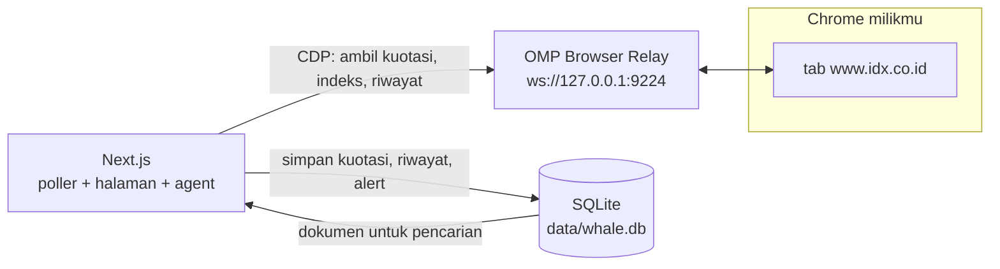
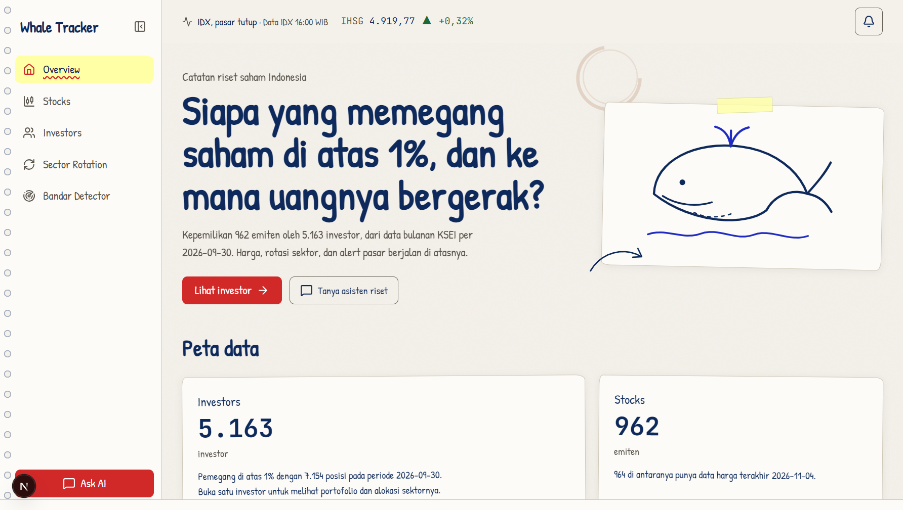
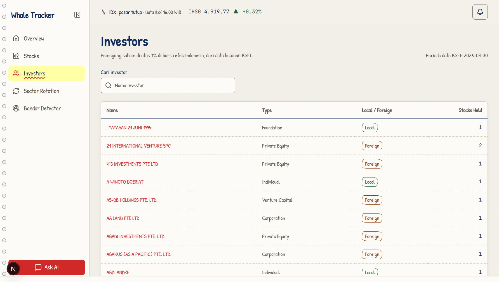
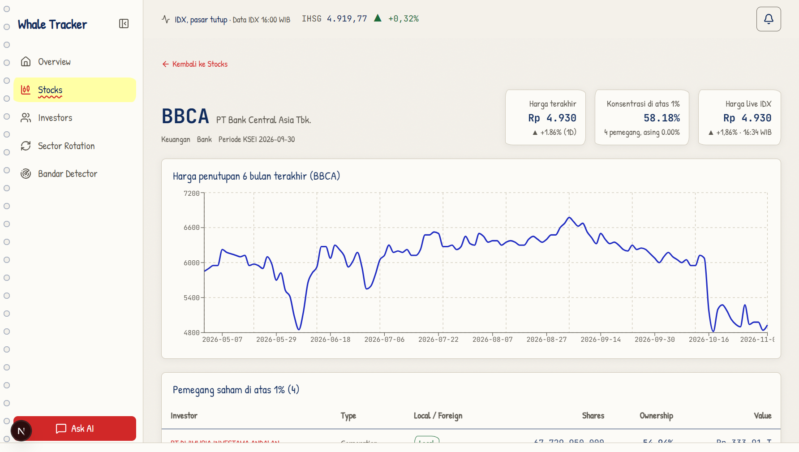
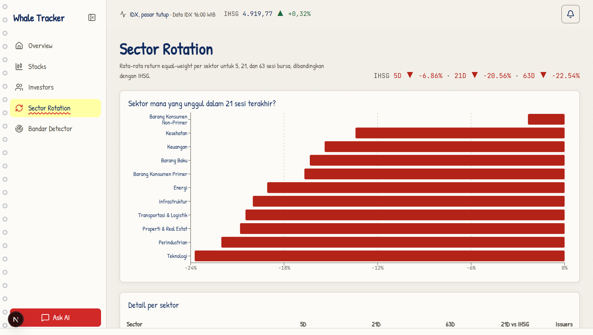
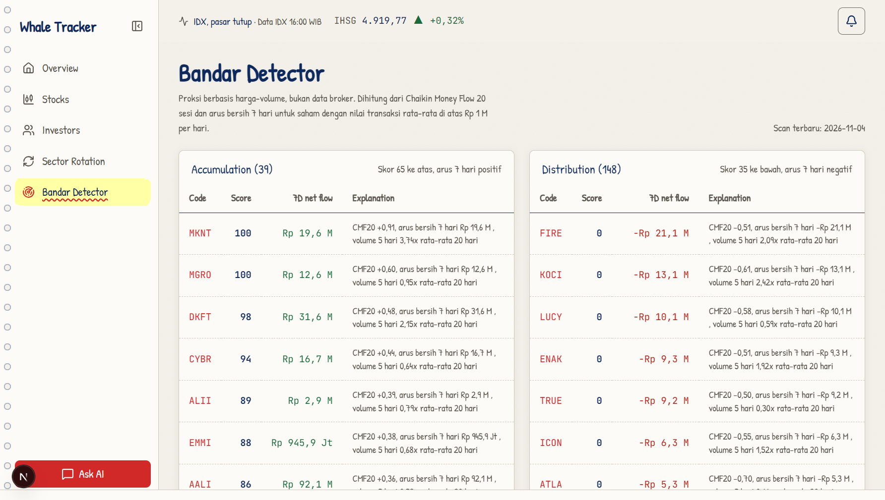

# Whale Tracker

Pelacak kepemilikan saham di atas 1% di Bursa Efek Indonesia, plus harga, rotasi sektor, dan alert pasar yang diambil langsung dari situs IDX.

Aplikasi Next.js ini berjalan lokal di mesinmu. Tidak ada akun, tidak ada langganan, dan data pasar tidak diambil dari API data pihak ketiga.

## Soal sumber data

Bagian ini yang paling menentukan bentuk proyeknya.

Situs IDX melindungi endpoint internalnya dengan Cloudflare. Permintaan HTTP biasa, `curl`, bahkan Chrome headless yang dijalankan terpisah ditolak dengan 403. Yang tembus hanya browser asli yang sudah melewati verifikasi itu.

Karena itu data pasar ditangkap lewat **OMP Browser Relay**: aplikasi mengendalikan tab `www.idx.co.id` di Chrome milikmu lewat Chrome DevTools Protocol, lalu menjalankan `fetch` dari dalam halaman tersebut. Permintaan itu membawa cookie dan sidik jari TLS browser asli, jadi IDX membalas seperti membalas pengunjung biasa.

Yang perlu ditegaskan, tanpa dibesar-besarkan:

- **Tidak ada API data pihak ketiga.** Tidak ada langganan penyedia data, tidak ada key API, tidak ada akun. Sumber harga, indeks, sektor, dan riwayat adalah endpoint milik situs IDX sendiri.
- **Bukan API resmi.** Endpoint `/primary/*` itu dipakai halaman IDX untuk dirinya sendiri. Bentuk responsnya bisa berubah kapan saja tanpa pemberitahuan.
- **Butuh Chrome yang menyala**, dengan tab `www.idx.co.id` terbuka dan sudah melewati Cloudflare. Kalau tab ditutup, tabel `Chart` akan berhenti bertambah dan bilah atas menampilkan capture terputus.
- **IDX membatasi laju.** Enam permintaan paralel ke `GetTradingInfoDaily` membuat 29 dari 50 dijawab 429 dan 6 dijawab 403. Karena itu poller berjalan satu permintaan setiap 1,5 detik dan berhenti 10 menit setiap kali menerima 429 atau 403.
- **Untuk pemakaian pribadi.** Kamu sendiri yang bertanggung jawab memastikan cara pengambilan ini sesuai ketentuan IDX. Repositori ini tidak memuat data IDX apa pun.

Data kepemilikan saham di atas 1% tetap berasal dari berkas bulanan KSEI yang kamu impor sendiri. Rilisnya bulanan, jadi tidak ada versi real-time dari data itu.

## Cara kerja



Alurnya:

1. `src/capture/relay.ts` membuka WebSocket ke relay, memilih satu-satunya tab `www.idx.co.id`, lalu hanya bisa menjalankan skrip di tab itu. Tab lain di Chrome-mu tidak disentuh.
2. `src/capture/idx.ts` menjalankan `fetch` dari dalam tab: `GetTradingInfoDaily` per saham untuk kuotasi, `GetIndexList` untuk IHSG, dan `GetStockSummary?date=` untuk riwayat harian seluruh pasar dalam satu permintaan.
3. `src/market/feed.ts` menarik watchlist tiap menit saat jam bursa, mendeteksi ambang yang baru terlewati, dan menyiarkan status serta alert lewat SSE.
4. `src/rag/live.ts` menulis ulang dokumen pasar dan dokumen per saham setiap kali data bergerak, sehingga agent menjawab dari angka terbaru, bukan dari kutipan lama.

## Yang ada di layar

- `/` ringkasan pasar, penggerak terbesar, dan catatan sumber data.
- `/investors` daftar pemegang di atas 1% dengan tipe dan status lokal atau asing.
- `/stocks` harga terakhir, pemegang terbesar, dan konsentrasi kepemilikan.
- `/sector-rotation` return 5, 21, dan 63 sesi per sektor dibanding IHSG.
- `/bandar-detector` proksi akumulasi dan distribusi dari harga dan volume, bukan data broker.
- Bilah atas berisi waktu data IDX, IHSG, dan lonceng notifikasi.
- Panel **Ask AI** memanggil agent yang punya tool untuk membaca database, mencari dokumen, dan menelusuri web.

### Tampilan

Seluruh angka di bawah diambil dari capture IDX pada 4 November 2026, 16:00 WIB.











## Menjalankan

Prasyarat: Node.js 24, Chrome, dan OMP dengan relay aktif.

```bash
npm install
cp .env.example .env.local
```

Pastikan relay menyala dan Chrome punya tab `https://www.idx.co.id` yang sudah lolos verifikasi Cloudflare. Lalu:

```bash
npm run sync:ownership      # impor xlsx KSEI di atas 1% dari data_src/1pct
npm run sync:market         # riwayat harian, IHSG, dan sektor dari IDX
npm run scan:bandar         # sinyal akumulasi dan distribusi
npm run index:rag           # dokumen untuk pencarian
npm run dev
```

`sync:market` menarik 125 sesi bursa secara default dan memakai dua permintaan per tanggal. Butuh beberapa menit. Kalau satu tanggal saja gagal, seluruh backfill dibatalkan supaya riwayat yang ada tidak terpotong. Ulangi saat IDX sudah tidak membatasi.

Variabel di `.env.local`:

| Kunci | Arti |
|---|---|
| `RELAY_URL` | Alamat relay, default `http://127.0.0.1:9224` |
| `IDX_WATCHLIST_SIZE` | Jumlah saham yang dipantau live, default 30, diambil dari nilai transaksi terbesar |
| `IDX_REQUEST_GAP_MS` | Jeda antar permintaan ke IDX, default 1500 |
| `LLM_BASE_URL`, `LLM_API_KEY`, `LLM_MODEL` | Endpoint LLM untuk panel Ask AI. Tanpa ini panel membalas 503 |
| `EMBEDDING_MODEL` | Opsional. Tanpa ini pencarian memakai FTS5 saja |

Agent tidak pernah menerima kutipan saham langsung dari model: setiap angka berasal dari tool yang membaca database atau dari capture IDX yang tersimpan.

## Peringatan keamanan

Relay memberi akses ke seluruh profil Chrome. Batas yang dipasang di kode ini:

- Hanya tab dengan host `www.idx.co.id` dan skema `https` yang bisa dipilih. Tab lain ditolak sebelum ada perintah apa pun.
- Skrip yang dijalankan bersifat tetap. Argumen yang masuk hanya kode saham yang divalidasi `[A-Z0-9]{4}`.
- Kode tidak pernah menavigasi, mengeklik, membaca cookie, atau menyentuh tab non-IDX.

Meski begitu, apa pun yang bisa menjalankan proses di mesinmu bisa memakai port relay itu. Kalau ingin lebih aman, jalankan Chrome dengan profil khusus untuk keperluan ini.

## Tes

```bash
npm test      # aturan alert, jam bursa, gerbang host relay, dokumen RAG, parsing
npm run build
```

## Struktur

| Path | Isi |
|---|---|
| `src/capture/` | Klien CDP ke relay dan seluruh permintaan ke IDX |
| `src/market/` | Poller, aturan alert, jam bursa, penyimpanan capture |
| `src/rag/` | Dokumen, embedding, pencarian campuran FTS5 dan vektor |
| `src/agent/` | Loop agent dan tool yang bisa dipanggil model |
| `src/analytics/` | Skor bandar dan rotasi sektor |
| `src/ingest/` | Impor xlsx KSEI dan backfill pasar dari IDX |
| `src/app/` | Halaman dan route API |

## Lisensi

MIT, lihat [LICENSE](LICENSE). Kode bebas dipakai dan diubah. Data IDX tidak termasuk dalam lisensi ini karena tidak ada data IDX yang disimpan di repositori.
